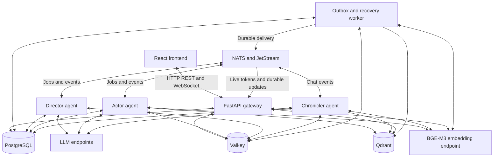

# fable. — Multi-agent roleplay application

A text-only application where users create scenarios, publish them, discover stories and continue private saved playthroughs. A FastAPI backend coordinates three Python agents through PostgreSQL and NATS. The React frontend supports responsive authoring, streaming chat, saved stories and Light/Dark/System themes.

**A world is optional.** A scenario can simply be a situation or conversation between characters. Place, world and era can be left blank. Images, uploads and object storage are not required.

Updated **26 November 2026**. See the linked guides and the running API's `/docs` and `/openapi.json` for detailed contracts.

## Contents

- [Features and terminology](#features-and-terminology)
- [System diagram](#system-diagram)
- [Components](#components)
- [Main system paths](#main-system-paths)
- [Local setup](#local-setup)
- [Configuration](#configuration)
- [Game state and scenario mechanics](#game-state-and-scenario-mechanics)
- [Search and discovery](#search-and-discovery)
- [API and frontend development](#api-and-frontend-development)
- [Operations and troubleshooting](#operations-and-troubleshooting)
- [Verification](#verification)
- [Repository and documentation](#repository-and-documentation)

## Features and terminology

Users can:

- Author scenarios with an optional setting, premise, opening, cast, lore and mechanics.
- Choose database-managed genres, tones and life-stage labels and publish immutable versions.
- Find scenarios through keyword, semantic or hybrid search with combined filters.
- Start private stories, receive streamed replies and resume saved progress later.
- Inspect inventory, relationships, quests, story time and current game state.
- Set writing preferences and reuse player personas.
- Inspect, correct, pin or suppress memories and maintain personal notes.
- Retry eligible failed turns, fork stories, regenerate replies or branch from edited actions.

| Term | Meaning |
|---|---|
| Scenario | Reusable authored premise, characters and optional setting/rules. |
| World/setting | Optional descriptive context; not a separate required entity. |
| Playthrough/conversation | One user's saved instance of a scenario, with messages, choices and state. |
| Roleplay | The ongoing interaction between the player and AI characters. |
| Published version | Immutable scenario definition pinned by a playthrough. |

## System diagram

**Add your system image here manually when it is ready.** Create `docs/images/`, save the image as `system-architecture.png`, then replace the comment below with its image line. No diagram image is needed to run the app.

<!-- Replace this comment after adding the file:

-->

This simplified overview can remain as a reference. Database arrows represent database access, not REST APIs. Agent connections include calls through shared Python utilities.



The embedding endpoint returns vectors to the calling process. It does **not** write to Qdrant itself. Agents coordinate through jobs/events rather than direct HTTP calls to one another. When drawing the image, distinguish HTTP, WebSocket, NATS and SQL connections; separate chat, memory and search diagrams are easier to follow than one canvas containing every arrow.

## Components

| Component | Responsibility |
|---|---|
| Frontend | Accounts, Discover, scenario authoring, saved stories, chat, state panels, preferences, personas and memory controls. |
| FastAPI gateway | Authentication, ownership checks, HTTP APIs, WebSocket tickets, turn acceptance and scenario search. |
| Director | Assesses actions before the reply and processes eligible authored events afterwards. Python authorizes mechanical effects. |
| Actor | Builds character context from SQL state and retrieved memory, generates replies and streams tokens. |
| Chronicler | Consumes chat events, maintains persisted history/memory and indexes summaries, episodes and lore. |
| Outbox worker | Delivers committed events, recovers expired jobs and maintains public scenario search vectors. |
| PostgreSQL | Authoritative accounts, drafts, publications, conversations, messages, game state, jobs, outbox, memories and checkpoints. |
| NATS + JetStream | Durable jobs/events and replay. Core NATS separately carries transient live-token updates. |
| Qdrant | Derived semantic indexes for conversation memory, lore and public scenario discovery. |
| Valkey | Shared provider admission limits, concurrency slots, circuit breaking, embedding cache and temporary search rankings. |
| LLM / BGE-M3 | LLMs generate decisions, prose and memory extraction; BGE-M3 creates dense retrieval embeddings. |
| OpenTelemetry | Local traces/metrics and optional OTLP export through a Collector. |

PostgreSQL is the source of truth. Qdrant and Valkey do not replace saved history or game state. Models propose actions; Python rules authorize inventory changes, quest effects and other mechanics.

## Main system paths

### Chat and turn processing

1. The frontend sends an action with a stable UUID `request_id`.
2. The gateway saves the turn, validation job and pending outbox handoff in PostgreSQL.
3. The outbox worker delivers the job through NATS/JetStream to the Director.
4. The Director assesses the action; Python validates the proposed effects. A blocked action ends without Actor generation.
5. An allowed action schedules the Actor through the SQL/outbox/NATS path.
6. The Actor loads SQL state and relevant memories/lore, then calls the LLM. Provisional tokens travel through Core NATS → gateway → WebSocket → frontend.
7. The Actor commits the full reply and schedules the Director's post-reply stage. Eligible authored story events are processed and the turn completes.
8. Durable completion/state updates reach the frontend. The Chronicler maintains memory in the background.

Job leases, fencing and transactional handoffs prevent stale workers from committing a stage twice. Persisted messages and resume/history responses recover the conversation after disconnects; token streams alone are not the saved history.

### Authoring and publication

`Frontend → FastAPI → SQL draft → immutable published version`

The catalog reads the latest public publication, not unsaved edits. Existing playthroughs retain their pinned version. Separately, the outbox worker detects public publications, embeds their public descriptions and indexes them in Qdrant. Publishing does not wait for an embedding provider.

### Memory and retrieval

`Chat events → Chronicler → SQL history/facts + LLM summaries → BGE-M3 → Qdrant`

For later replies, the Actor embeds a retrieval query, searches scoped Qdrant memory/lore and combines relevant results with SQL history/state before generating a reply. Embedding calls and vector writes are separate operations made by Python services.

### Search and resume

Search: `Description → backend → BGE-M3 → Qdrant candidates → SQL checks → results`. Hybrid also retrieves PostgreSQL lexical matches and fuses the rankings.

Resume: `Frontend → resume/history APIs → persisted messages, state and turn status → WebSocket reconnect`. Opening a saved story does not call the start endpoint again. Retry continues an eligible failed stage; fork/edit/regenerate create branches with different checkpoint semantics.

## Local setup

### Prerequisites

- **Python 3.14+**, as declared in `pyproject.toml`.
- PostgreSQL with an application database; the current local setup uses PostgreSQL 18.
- NATS with **JetStream enabled**, Qdrant and Valkey.
- Configured LLM and BGE-M3 endpoints and credentials.
- A modern browser. Node.js is useful for frontend checks; normal serving needs no npm build.
- Docker Compose if using the supplied containers. PostgreSQL can run locally outside Docker.

### 1. Python environment

From the repository root in PowerShell:

```powershell
python -m venv venv
.\venv\Scripts\Activate.ps1
python -m pip install -e .
if (!(Test-Path -LiteralPath .env)) { Copy-Item .env.example .env }
```

Edit the **root `.env`**. Both launchers run services from the root; separate environment files in every agent folder are unnecessary. Replace example credentials and clear placeholder keys for services without authentication.

### 2. Infrastructure

If using the repository's development Compose services:

```powershell
docker compose up -d nats-jetstream valkey-dev qdrant-dev valkey-admin
```

This does not start PostgreSQL or the Python stack. If dependencies are already running separately, configure their addresses instead of starting conflicting containers.

| Service | Default local address |
|---|---|
| PostgreSQL | `127.0.0.1:5432` |
| NATS client | `nats://127.0.0.1:4222` |
| NATS monitoring | `http://127.0.0.1:8222` |
| Qdrant REST / dashboard | `http://127.0.0.1:6333` / `http://127.0.0.1:6333/dashboard` |
| Valkey protocol | `redis://127.0.0.1:6379/0` |
| Valkey UI in this Compose file | `http://127.0.0.1:8081` |

Valkey is **not an HTTP server**: opening port 6379 in a browser will not display databases. The included admin container connects to `valkey-dev:6379`. A separate admin UI may use another published port or connection address.

### 3. Database initialization

Create an empty database using PostgreSQL tools, for example:

```sql
CREATE DATABASE roleplay;
```

Set `DATABASE_URL` to that database. Choose one initialization route:

- **Migrations:** `python -m shared.db.migrate` applies versioned upgrades. Both application launchers also run migrations automatically.
- **Fresh snapshot:** apply `database.sql` once to an empty database. It includes the full schema, migration registration and discovery taxonomy configuration, but no accounts or stories.

Do not apply the fresh snapshot over existing tables. Existing installations use migrations. Do not edit applied migrations: their checksums are verified. The repository currently contains migrations `001`–`011`.

### 4. Start the backend

```powershell
python tools/run_stack.py
```

The supervisor applies migrations and starts **five processes**: gateway, Actor, Director, Chronicler and outbox/recovery worker. Logs are written to `logs/<service>.log`. Ctrl+C stops the stack. Another terminal can request shutdown with:

```powershell
python tools/run_stack.py --stop
```

Git Bash/Linux users can use `bash run.sh` instead. Do not run both launchers together. On Windows, use the provided launchers: they configure a PostgreSQL-compatible asyncio event loop.

API: [http://127.0.0.1:8000](http://127.0.0.1:8000). Interactive docs: [http://127.0.0.1:8000/docs](http://127.0.0.1:8000/docs).

### 5. Serve the frontend

In a separate terminal from the repository root:

```powershell
python -m http.server 5500 --directory frontend
```

Open [http://127.0.0.1:5500](http://127.0.0.1:5500), register an account and create a scenario. Both `frontend/index.html` and `frontend/app.html` launch the same React client. Its default API base is `http://localhost:8000`, configurable in the UI. Serve over HTTP rather than opening a `file://` page.

## Configuration

Use root `.env.example` as a template. Never commit `.env` or publish provider keys.

| Variables | Purpose |
|---|---|
| `DATABASE_URL` | PostgreSQL database and credentials. |
| `NATS_URL`, optional `NATS_USER`, `NATS_PASSWORD` | Broker connection/authentication. |
| `QDRANT_URL`, optional `QDRANT_API_KEY` | Vector database connection. Clear placeholder keys when unused. |
| `VALKEY_URL` | Valkey instance/database. |
| `LLM_API_URL`, `LLM_API_KEY`, `LLM_MODEL` | Default chat-completions provider/model. |
| `DIGITALOCEAN_BGE_URL`, `DIGITALOCEAN_BGE_KEY` | BGE-M3 endpoint/key; existing variable names retained by the integration. |
| `LLM_MAX_TOKENS`, `LLM_TEMPERATURE`, `MODEL_CONTEXT_TOKENS` | Generation/context budgets. |
| `PROVIDER_RPM`, `PROVIDER_TPM`, `PROVIDER_CONCURRENCY` | Shared provider admission limits. |
| `JOB_TIMEOUT_SECONDS`, `MEMORY_MAX_TOKENS` | Worker and memory-extraction budgets. |
| `API_PORT`, `LOG_LEVEL` | Gateway port and logging. |
| `NATS_RETENTION_SECONDS`, `NATS_STREAM_MAX_BYTES` | Bounded broker replay retention, independent of SQL history. |
| `OTEL_EXPORTER_OTLP_ENDPOINT` | Optional Collector base URL, usually `http://127.0.0.1:4318`. |

Per-role `VALIDATION_*`, `DIRECTOR_*` and `MEMORY_*` model/API URL/API key overrides are supported. `PROVIDER_BUDGET_GROUP` optionally shares provider-account budgets across endpoints. Restart services after environment changes.

The current embedding integration expects BGE-M3 **1024-dimensional dense vectors**. Changing embedding models/dimensions requires a deliberate collection/index rebuild; do not mix embedding spaces in an existing collection.

## Game state and scenario mechanics

Freeform scenarios can keep the defaults and omit setting, inventory and quests entirely. Structured scenarios can define commands/effects in `rules.transitions` and eligible story events in `rules.world_events`.

`game_states` stores:

| Field/data | Meaning |
|---|---|
| `conversation_id` | Playthrough owning this state. |
| `inventory` JSONB | Item objects with stable ID, name, description and positive quantity. |
| `relationships` JSONB | Character-name keys mapping to character name, affinity score (−100 to 100) and relationship status. |
| `quest_flags` text array | Authored flags recorded for this playthrough. |
| Runtime/state metadata | Quest progress, character state, story time, state versions and timestamps. |

Quest lifecycle rules distinguish inactive, active, completed, failed and explicit restart. Regeneration uses a before-reply checkpoint; completed-turn effects are not incorrectly included in the regenerated reply's context. Fork/edit have their own checkpoint semantics: consult [ROLEPLAY_API.md](ROLEPLAY_API.md).

Archiving a scenario hides its template/catalog entry without erasing players' saved stories. Creator edits do not rewrite existing pinned playthroughs. Discovery labels become public with the next publication; existing scenarios receive no guessed labels. Terms marked as requiring an adult cast validate explicit character ages of at least 18. Youthful themes are separate from adult romance/life-stage categories; this is not user age verification.

## Search and discovery

| Mode | Behavior |
|---|---|
| Browse | Latest-first public scenarios with descending-ID pagination. |
| Title & keywords | PostgreSQL full-text plus literal partial-title and creator-name `ILIKE` matching. |
| Similar themes | BGE-M3 embeds the description; Qdrant retrieves conceptually similar publications. |
| Hybrid, the text-search default | Combines SQL and vector rankings using reciprocal rank fusion. |

Genre, tone, life-stage, AI-character gender and play-style filters combine with search. Options and gender aliases come from PostgreSQL `catalog_terms`, not a fixed frontend list.

Public discovery uses `catalog_bge_m3_v1`, separate from conversation/lore retrieval. Only public premise and selected cast information is embedded. SQL rechecks visibility, latest publication and filters on every page.

Keyword publication visibility is immediate. Semantic indexing is asynchronous: the worker polls every 10 seconds, processes bounded batches and retries failures. Hybrid falls back to keywords with a visible warning if semantic retrieval fails; Semantic-only returns a service error. Ranked searches use five-minute user-bound Valkey snapshots and a bounded top-200 window, not an unlimited total-results guarantee.

See [DISCOVERY_GUIDE.md](frontend/DISCOVERY_GUIDE.md) for taxonomy SQL operations and [SEMANTIC_SEARCH.md](frontend/SEMANTIC_SEARCH.md) for indexing, endpoints, pagination and operational limits.

## API and frontend development

Use `/docs` and `/openapi.json` for exact schemas. Main routes include:

| Area | Routes |
|---|---|
| Accounts | `/users/register`, `/users/login`, `/users/rotate-key` |
| Authoring | `/scenarios`, `/characters`, `/scenarios/{id}/lore`, `/scenarios/{id}/publish` |
| Discovery | `/catalog/scenarios`, `/catalog/filters`, `/catalog/search` |
| Chat | `/chat/start`, `/chat/send`, `/chat/history/{conversation_id}`, `/chat/turn/{turn_id}` and its `/retry` route |
| WebSocket | Obtain a single-use ticket at `/chat/ticket/{conversation_id}`, then connect to `/chat/ws/{conversation_id}`. |
| Saved stories | `/conversations`, `/conversations/{id}/resume`, conversation update/branch endpoints |
| Personalization | `/preferences`, `/personas`, conversation memory/note endpoints |

Authenticated HTTP calls use `X-API-Key`. Login rotates the key, so another session can become unauthorized. Keep keys out of URLs/logs. Retry an identical chat submission with the same `request_id`; use a new UUID for a different action.

The zero-build frontend uses locally vendored React/ReactDOM and browser-global modules. Most `.ts`/`.tsx` sources are plain JavaScript with identical served `.js` copies. Two files—`src/api/client.ts` and `src/components/ConfirmDialog.tsx`—have real TypeScript and generated runtimes. Check them with `tsc -p frontend/tsconfig.json`; regeneration instructions are in [frontend/README.md](frontend/README.md).

The client protects unsaved drafts, validates authoring fields/JSON, binds sessions to the API base and blocks authenticated redirect following. Keys currently remain in localStorage. Its CSP permits local scripts; POST/PUT/PATCH bodies are limited to 1 MiB. These are existing application controls, not a claim of production hardening. Supplied Compose settings are for local development.

## Operations and troubleshooting

### Health and logs

| Check | Meaning |
|---|---|
| `GET /health` | Gateway process responds. |
| `GET /ready` | PostgreSQL, NATS/JetStream, Valkey and Actor/Director/Chronicler/outbox health responders are available. |
| `GET /diagnostics` | Job counts, outbox backlog and stage latency. |
| `logs/<service>.log` | Application logs; supervisor startup rewrites these files. |
| `logs/telemetry/` | Local rotating traces and metrics. |

Readiness does **not** test a real LLM response, embedding request or Qdrant query. `python tools/smoke_check.py` probes configured dependencies/providers and can make real model requests; some checks depend on active workers.

| Symptom | Check |
|---|---|
| PostgreSQL authentication/missing database | Verify `DATABASE_URL`, database existence and permissions. |
| Windows async PostgreSQL loop error | Use the supplied launcher instead of a separate Uvicorn CLI command. |
| Turn stays pending | Director/Actor/outbox logs, `/ready`, SQL job status and NATS availability. |
| Missing semantic matches | BGE/Qdrant connectivity, outbox logs and indexing progress; use Keyword while indexing catches up. |
| Search returns 410 | Its five-minute snapshot expired; rerun the search. |
| New labels do not affect the catalog | Save and publish a new version; refresh options after taxonomy changes. |
| Valkey UI has no keys | Verify instance/database number. Keys are created lazily and may expire. |
| Port already used | Stop the previous stack or change its configured port; do not run both launchers. |

### Optional OpenTelemetry Collector

```powershell
python -m pip install -e ".[telemetry]"
```

Set `OTEL_EXPORTER_OTLP_ENDPOINT=http://127.0.0.1:4318` in `.env` and restart the Python stack. Choose **one** Collector setup:

- Main Compose project: `docker compose up -d otel-collector`.
- Standalone: `docker compose -f compose.telemetry.yaml up -d`.

Do not run both on the same ports. OTLP HTTP uses 4318; health is at `http://127.0.0.1:13133/`. Inspect data with the matching Compose command, for example `docker compose logs --tail 30 otel-collector`. The supplied Collector uses a debug exporter, not a persistent trace dashboard.

## Verification

From the activated Python environment:

```powershell
# Default regressions; service-dependent tests may be skipped.
python -m unittest discover -s tests -v

# Include integration checks against configured development services.
$env:RUN_BACKEND_INTEGRATION='1'
python -m unittest discover -s tests -v
Remove-Item Env:RUN_BACKEND_INTEGRATION

# Frontend checks require Node.js.
node --test frontend/tests/transport.test.cjs frontend/tests/authoring.test.cjs

# Verify the fresh-install snapshot in a temporary schema, then roll back.
python tools/check_database_schema.py
```

Refresh the fresh-install snapshot after migrations or taxonomy configuration changes:

```powershell
python tools/export_database_schema.py
python tools/check_database_schema.py
```

Export needs a matching PostgreSQL `pg_dump` client. It excludes user content and credentials, but includes taxonomy configuration and migration records. Automated tests are bounded evidence; exercise affected authoring/chat/search flows in a browser when changing them.

## Repository and documentation

```text
fastapi_server/      HTTP/WebSocket gateway and application services
actor_agent/        Character generation and streaming
director_agent/     Action assessment and story events
chronicler_agent/   History and memory/lore maintenance
shared/             Models, DB clients, game engine, jobs, retrieval and outbox
frontend/           React client, styles, vendor scripts and frontend tests
migrations/         Checksummed incremental SQL migrations
tools/              Launch, health, schema and source-sync utilities
tests/              Backend unit/integration regressions
config/, deploy/    NATS and telemetry configuration
database.sql        Fresh-install schema and discovery configuration
```

- [API and gameplay contracts](ROLEPLAY_API.md)
- [Implementation notes](IMPLEMENTATION_NOTES.md)
- [Backend upgrade notes](BACKEND_UPGRADE.md)
- [Frontend setup and implementation](frontend/README.md)
- [Frontend integration guide](frontend/FRONTEND_GUIDE.md)
- [Discovery taxonomy and SQL operations](frontend/DISCOVERY_GUIDE.md)
- [Semantic/hybrid search architecture](frontend/SEMANTIC_SEARCH.md)
